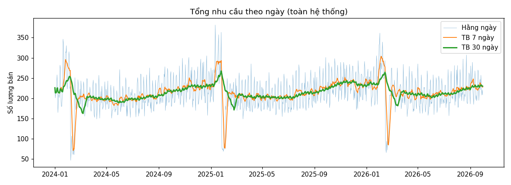
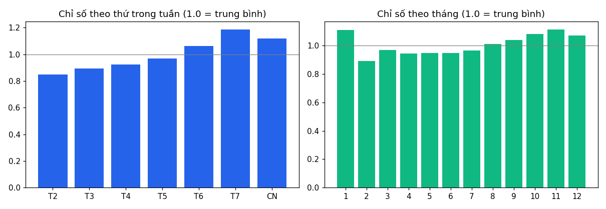
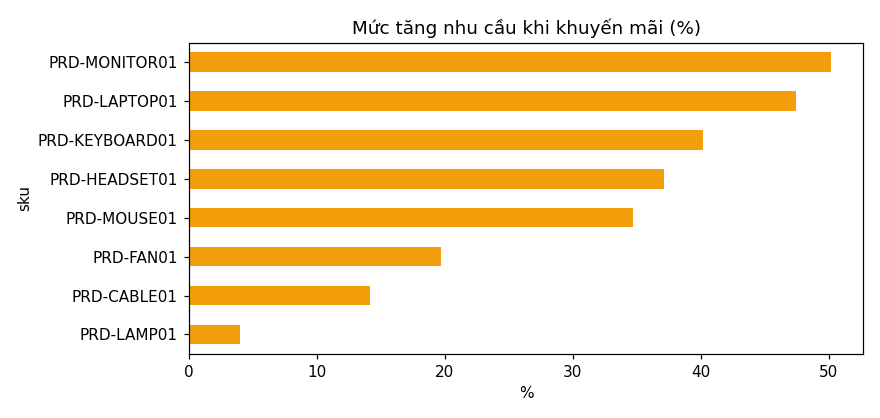
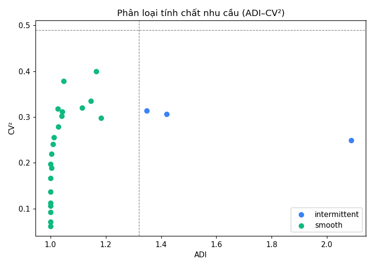

# Báo cáo EDA – Dữ liệu nhu cầu (Sprint7-03)

> ⚠ **Dữ liệu MÔ PHỎNG** (sinh bởi `s01_collect_sales_dataset.py`). Các quy luật bên dưới
> phản ánh giả định khi sinh dữ liệu, **không** phải hành vi khách hàng thật. Chạy lại pipeline
> với dữ liệu thật rồi tái tạo báo cáo này trước khi rút kết luận cho mô hình.

- Số ngày: **1004**, tổng lượng bán: **215,591**, số chuỗi (SKU × kho): **24**
- Tỉ lệ dòng được điền bổ sung (`is_imputed`): **2.87%**

## 1. Xu hướng

Tăng trưởng 12 tháng gần nhất so với 12 tháng trước, theo SKU:

| SKU | Thay đổi |
|---|---:|
| PRD-CABLE01 | +1.9% |
| PRD-FAN01 | +4.7% |
| PRD-HEADSET01 | +9.1% |
| PRD-KEYBOARD01 | +2.8% |
| PRD-LAMP01 | +0.8% |
| PRD-LAPTOP01 | +5.4% |
| PRD-MONITOR01 | +2.1% |
| PRD-MOUSE01 | +4.7% |

## 2. Tính mùa vụ

- **Thứ trong tuần:** cao nhất T7 (×1.19), thấp nhất T2 (×0.85).
- **Tháng:** cao nhất tháng 11 (×1.11), thấp nhất tháng 2 (×0.89).
- **Tự tương quan** (sau khi bỏ xu hướng): lag 1 = 0.495, lag 7 = 0.37, lag 14 = 0.305, lag 28 = 0.501.
  Lag 7 cao ⇒ chu kỳ tuần rõ, nên có feature `day_of_week` và lag 7/14/28.

## 3. Ảnh hưởng của sự kiện

- **Nghỉ Tết** (−3…+5 ngày quanh mùng 1): nhu cầu chuẩn hóa ≈ **0.37** (1.0 = trung bình).
- **Trước Tết** (−21…−4 ngày): ≈ **1.31**.
- Lịch Tết/ngày lễ phải đưa vào feature (Sprint7-05); lịch dương thông thường không bắt được hiệu ứng này.

### Khuyến mãi

Mức tăng trung bình khi khuyến mãi: **+30.9%** (từ +4.0% đến +50.2%). `promotion_flag` là feature ngoại sinh đáng giữ.

## 4. Tính chất nhu cầu (ADI–CV²)

Phân bố: smooth = 21, intermittent = 3.

| Chuỗi | TB/ngày | % ngày không bán | ADI | CV² | Loại |
|---|---:|---:|---:|---:|---|
| PRD-CABLE01 @ KHO-HCM01 | 37.57 | 0.0 | 1.0 | 0.062 | smooth |
| PRD-CABLE01 @ KHO-HN01 | 26.41 | 0.0 | 1.0 | 0.071 | smooth |
| PRD-MOUSE01 @ KHO-HCM01 | 24.61 | 0.0 | 1.0 | 0.092 | smooth |
| PRD-MOUSE01 @ KHO-HN01 | 17.07 | 0.0 | 1.0 | 0.106 | smooth |
| PRD-KEYBOARD01 @ KHO-HCM01 | 13.5 | 0.0 | 1.0 | 0.137 | smooth |
| PRD-CABLE01 @ KHO-DN01 | 13.23 | 0.0 | 1.0 | 0.113 | smooth |
| PRD-HEADSET01 @ KHO-HCM01 | 10.8 | 0.0 | 1.0 | 0.197 | smooth |
| PRD-KEYBOARD01 @ KHO-HN01 | 9.44 | 0.0 | 1.0 | 0.167 | smooth |
| PRD-MOUSE01 @ KHO-DN01 | 8.5 | 0.3 | 1.003 | 0.189 | smooth |
| PRD-HEADSET01 @ KHO-HN01 | 7.77 | 0.3 | 1.003 | 0.22 | smooth |
| PRD-FAN01 @ KHO-HCM01 | 6.73 | 2.6 | 1.027 | 0.318 | smooth |
| PRD-MONITOR01 @ KHO-HCM01 | 5.82 | 0.9 | 1.009 | 0.241 | smooth |
| PRD-FAN01 @ KHO-HN01 | 4.78 | 4.5 | 1.047 | 0.379 | smooth |
| PRD-KEYBOARD01 @ KHO-DN01 | 4.7 | 1.2 | 1.012 | 0.256 | smooth |
| PRD-MONITOR01 @ KHO-HN01 | 4.13 | 2.7 | 1.028 | 0.279 | smooth |
| PRD-HEADSET01 @ KHO-DN01 | 3.79 | 4.1 | 1.043 | 0.312 | smooth |
| PRD-LAPTOP01 @ KHO-HCM01 | 3.57 | 3.9 | 1.04 | 0.302 | smooth |
| PRD-LAPTOP01 @ KHO-HN01 | 2.56 | 10.3 | 1.114 | 0.32 | smooth |
| PRD-FAN01 @ KHO-DN01 | 2.45 | 14.2 | 1.166 | 0.4 | smooth |
| PRD-MONITOR01 @ KHO-DN01 | 2.13 | 12.7 | 1.146 | 0.335 | smooth |
| PRD-LAMP01 @ KHO-HCM01 | 1.95 | 15.4 | 1.183 | 0.298 | smooth |
| PRD-LAMP01 @ KHO-HN01 | 1.32 | 25.9 | 1.349 | 0.314 | intermittent |
| PRD-LAPTOP01 @ KHO-DN01 | 1.22 | 29.6 | 1.42 | 0.306 | intermittent |
| PRD-LAMP01 @ KHO-DN01 | 0.68 | 52.1 | 2.087 | 0.249 | intermittent |

**Hàm ý cho mô hình:** chuỗi smooth/erratic hợp Random Forest/XGBoost/Prophet; chuỗi intermittent/lumpy (nhiều ngày = 0) nên đánh giá bằng MAE/WAPE thay vì MAPE (MAPE chia cho 0 hoặc bị phóng đại), và cân nhắc dự báo theo tuần.
