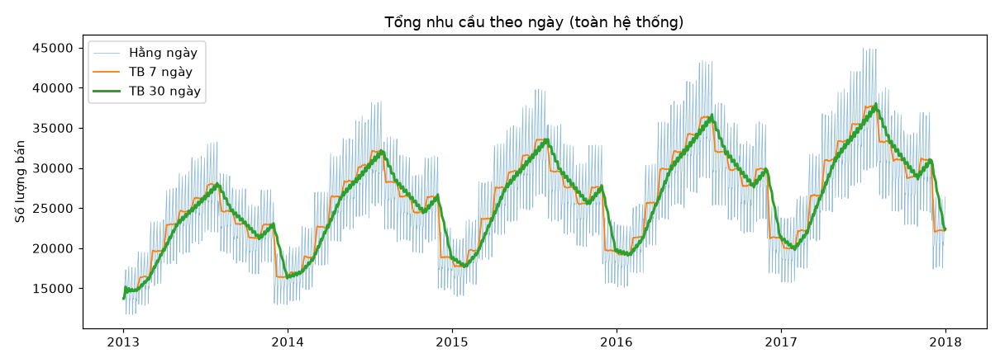
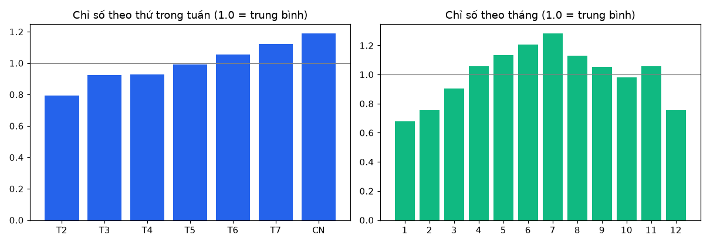
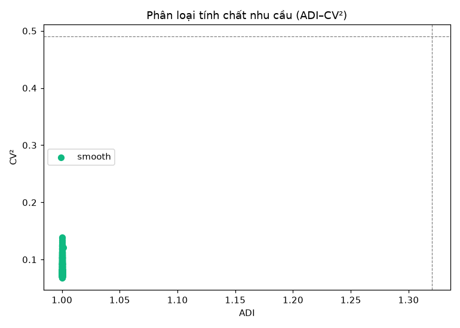

# Báo cáo EDA – Dữ liệu nhu cầu

- Số ngày: **1826**, tổng lượng bán: **47,704,510**, số chuỗi (SKU × kho): **500**
- Tỉ lệ dòng được điền bổ sung (`is_imputed`): **0.0%**

## 1. Xu hướng

Tăng trưởng 12 tháng gần nhất so với 12 tháng trước, theo SKU:

| SKU | Thay đổi |
|---|---:|
| 1 | +3.4% |
| 10 | +3.9% |
| 11 | +3.8% |
| 12 | +3.7% |
| 13 | +3.6% |
| 14 | +3.5% |
| 15 | +3.7% |
| 16 | +3.8% |
| 17 | +2.8% |
| 18 | +3.7% |
| 19 | +3.8% |
| 2 | +3.4% |
| 20 | +3.5% |
| 21 | +3.7% |
| 22 | +3.2% |
| 23 | +3.6% |
| 24 | +3.4% |
| 25 | +3.1% |
| 26 | +3.5% |
| 27 | +3.1% |
| 28 | +3.6% |
| 29 | +3.9% |
| 3 | +4.2% |
| 30 | +3.5% |
| 31 | +3.5% |
| 32 | +4.5% |
| 33 | +4.0% |
| 34 | +3.8% |
| 35 | +3.8% |
| 36 | +3.5% |
| 37 | +3.9% |
| 38 | +3.7% |
| 39 | +3.5% |
| 4 | +2.9% |
| 40 | +3.5% |
| 41 | +3.8% |
| 42 | +3.3% |
| 43 | +4.0% |
| 44 | +3.5% |
| 45 | +3.9% |
| 46 | +3.3% |
| 47 | +4.0% |
| 48 | +4.0% |
| 49 | +4.3% |
| 5 | +3.8% |
| 50 | +3.2% |
| 6 | +3.2% |
| 7 | +3.5% |
| 8 | +4.0% |
| 9 | +3.6% |

## 2. Tính mùa vụ

- **Thứ trong tuần:** cao nhất CN (×1.19), thấp nhất T2 (×0.79).
- **Tháng:** cao nhất tháng 7 (×1.28), thấp nhất tháng 1 (×0.68).
- **Tự tương quan** (sau khi bỏ xu hướng): lag 1 = 0.165, lag 7 = 0.914, lag 14 = 0.899, lag 28 = 0.926.
  Lag 7 cao ⇒ chu kỳ tuần rõ, nên có feature `day_of_week` và lag 7/14/28.

## 3. Ảnh hưởng của sự kiện

- **Nghỉ Tết** (−3…+5 ngày quanh mùng 1): nhu cầu chuẩn hóa ≈ **nan** (1.0 = trung bình).
- **Trước Tết** (−21…−4 ngày): ≈ **nan**.
- Lịch Tết/ngày lễ phải đưa vào feature (bước đặc trưng lịch); lịch dương thông thường không bắt được hiệu ứng này.

## 4. Tính chất nhu cầu (ADI–CV²)

Phân bố: smooth = 500.

| Chuỗi | TB/ngày | % ngày không bán | ADI | CV² | Loại |
|---|---:|---:|---:|---:|---|
| 28 @ 2 | 112.64 | 0.0 | 1.0 | 0.069 | smooth |
| 15 @ 2 | 112.58 | 0.0 | 1.0 | 0.069 | smooth |
| 18 @ 2 | 108.12 | 0.0 | 1.0 | 0.07 | smooth |
| 15 @ 8 | 108.05 | 0.0 | 1.0 | 0.068 | smooth |
| 13 @ 2 | 107.9 | 0.0 | 1.0 | 0.07 | smooth |
| 28 @ 8 | 107.81 | 0.0 | 1.0 | 0.069 | smooth |
| 18 @ 8 | 103.82 | 0.0 | 1.0 | 0.07 | smooth |
| 13 @ 8 | 103.82 | 0.0 | 1.0 | 0.069 | smooth |
| 25 @ 2 | 103.43 | 0.0 | 1.0 | 0.072 | smooth |
| 45 @ 2 | 103.38 | 0.0 | 1.0 | 0.07 | smooth |
| 38 @ 2 | 103.25 | 0.0 | 1.0 | 0.069 | smooth |
| 22 @ 2 | 103.01 | 0.0 | 1.0 | 0.069 | smooth |
| 15 @ 3 | 100.42 | 0.0 | 1.0 | 0.071 | smooth |
| 28 @ 3 | 100.14 | 0.0 | 1.0 | 0.069 | smooth |
| 25 @ 8 | 99.24 | 0.0 | 1.0 | 0.07 | smooth |
| 8 @ 2 | 99.09 | 0.0 | 1.0 | 0.07 | smooth |
| 15 @ 10 | 98.99 | 0.0 | 1.0 | 0.069 | smooth |
| 38 @ 8 | 98.95 | 0.0 | 1.0 | 0.071 | smooth |
| 45 @ 8 | 98.94 | 0.0 | 1.0 | 0.071 | smooth |
| 22 @ 8 | 98.91 | 0.0 | 1.0 | 0.071 | smooth |
| 28 @ 10 | 98.77 | 0.0 | 1.0 | 0.07 | smooth |
| 36 @ 2 | 98.77 | 0.0 | 1.0 | 0.069 | smooth |
| 13 @ 3 | 96.21 | 0.0 | 1.0 | 0.071 | smooth |
| 18 @ 3 | 96.09 | 0.0 | 1.0 | 0.071 | smooth |
| 18 @ 10 | 94.72 | 0.0 | 1.0 | 0.069 | smooth |
| 13 @ 10 | 94.68 | 0.0 | 1.0 | 0.07 | smooth |
| 8 @ 8 | 94.46 | 0.0 | 1.0 | 0.072 | smooth |
| 36 @ 8 | 94.37 | 0.0 | 1.0 | 0.07 | smooth |
| 10 @ 2 | 94.1 | 0.0 | 1.0 | 0.07 | smooth |
| 15 @ 9 | 93.14 | 0.0 | 1.0 | 0.07 | smooth |
| 28 @ 9 | 92.79 | 0.0 | 1.0 | 0.073 | smooth |
| 15 @ 4 | 92.65 | 0.0 | 1.0 | 0.069 | smooth |
| 28 @ 4 | 92.55 | 0.0 | 1.0 | 0.072 | smooth |
| 38 @ 3 | 91.87 | 0.0 | 1.0 | 0.073 | smooth |
| 45 @ 3 | 91.85 | 0.0 | 1.0 | 0.071 | smooth |
| 22 @ 3 | 91.85 | 0.0 | 1.0 | 0.071 | smooth |
| 25 @ 3 | 91.84 | 0.0 | 1.0 | 0.069 | smooth |
| 45 @ 10 | 90.69 | 0.0 | 1.0 | 0.072 | smooth |
| 22 @ 10 | 90.53 | 0.0 | 1.0 | 0.071 | smooth |
| 25 @ 10 | 90.5 | 0.0 | 1.0 | 0.071 | smooth |
| 38 @ 10 | 90.1 | 0.0 | 1.0 | 0.07 | smooth |
| 10 @ 8 | 89.82 | 0.0 | 1.0 | 0.071 | smooth |
| 12 @ 2 | 89.35 | 0.0 | 1.0 | 0.073 | smooth |
| 33 @ 2 | 89.31 | 0.0 | 1.0 | 0.073 | smooth |
| 11 @ 2 | 89.31 | 0.0 | 1.0 | 0.073 | smooth |
| 29 @ 2 | 88.97 | 0.0 | 1.0 | 0.069 | smooth |
| 18 @ 9 | 88.61 | 0.0 | 1.0 | 0.074 | smooth |
| 13 @ 4 | 88.6 | 0.0 | 1.0 | 0.071 | smooth |
| 13 @ 9 | 88.51 | 0.0 | 1.0 | 0.071 | smooth |
| 18 @ 4 | 88.5 | 0.0 | 1.0 | 0.071 | smooth |
| 36 @ 3 | 87.76 | 0.0 | 1.0 | 0.073 | smooth |
| 8 @ 3 | 87.52 | 0.0 | 1.0 | 0.073 | smooth |
| 36 @ 10 | 86.63 | 0.0 | 1.0 | 0.072 | smooth |
| 8 @ 10 | 86.18 | 0.0 | 1.0 | 0.073 | smooth |
| 12 @ 8 | 85.64 | 0.0 | 1.0 | 0.071 | smooth |
| 11 @ 8 | 85.5 | 0.0 | 1.0 | 0.072 | smooth |
| 33 @ 8 | 85.35 | 0.0 | 1.0 | 0.073 | smooth |
| 29 @ 8 | 85.23 | 0.0 | 1.0 | 0.075 | smooth |
| 25 @ 9 | 85.14 | 0.0 | 1.0 | 0.074 | smooth |
| 45 @ 9 | 85.09 | 0.0 | 1.0 | 0.075 | smooth |
| 25 @ 4 | 85.02 | 0.0 | 1.0 | 0.071 | smooth |
| 22 @ 9 | 84.86 | 0.0 | 1.0 | 0.072 | smooth |
| 24 @ 2 | 84.78 | 0.0 | 1.0 | 0.071 | smooth |
| 45 @ 4 | 84.69 | 0.0 | 1.0 | 0.073 | smooth |
| 35 @ 2 | 84.66 | 0.0 | 1.0 | 0.073 | smooth |
| 38 @ 9 | 84.64 | 0.0 | 1.0 | 0.074 | smooth |
| 22 @ 4 | 84.63 | 0.0 | 1.0 | 0.07 | smooth |
| 50 @ 2 | 84.62 | 0.0 | 1.0 | 0.073 | smooth |
| 38 @ 4 | 84.57 | 0.0 | 1.0 | 0.072 | smooth |
| 10 @ 3 | 83.39 | 0.0 | 1.0 | 0.072 | smooth |
| 10 @ 10 | 82.23 | 0.0 | 1.0 | 0.072 | smooth |
| 36 @ 9 | 81.45 | 0.0 | 1.0 | 0.072 | smooth |
| 8 @ 9 | 81.29 | 0.0 | 1.0 | 0.074 | smooth |
| 24 @ 8 | 81.21 | 0.0 | 1.0 | 0.074 | smooth |
| 36 @ 4 | 81.03 | 0.0 | 1.0 | 0.073 | smooth |
| 50 @ 8 | 80.97 | 0.0 | 1.0 | 0.072 | smooth |
| 35 @ 8 | 80.84 | 0.0 | 1.0 | 0.073 | smooth |
| 8 @ 4 | 80.82 | 0.0 | 1.0 | 0.074 | smooth |
| 29 @ 3 | 79.68 | 0.0 | 1.0 | 0.073 | smooth |
| 15 @ 1 | 79.68 | 0.0 | 1.0 | 0.074 | smooth |
| 28 @ 1 | 79.57 | 0.0 | 1.0 | 0.073 | smooth |
| 11 @ 3 | 79.29 | 0.0 | 1.0 | 0.073 | smooth |
| 33 @ 3 | 79.13 | 0.0 | 1.0 | 0.072 | smooth |
| 12 @ 3 | 79.08 | 0.0 | 1.0 | 0.073 | smooth |
| 33 @ 10 | 78.36 | 0.0 | 1.0 | 0.075 | smooth |
| 11 @ 10 | 78.27 | 0.0 | 1.0 | 0.075 | smooth |
| 29 @ 10 | 78.24 | 0.0 | 1.0 | 0.07 | smooth |
| 12 @ 10 | 78.06 | 0.0 | 1.0 | 0.076 | smooth |
| 10 @ 9 | 77.11 | 0.0 | 1.0 | 0.074 | smooth |
| 10 @ 4 | 77.05 | 0.0 | 1.0 | 0.073 | smooth |
| 18 @ 1 | 76.35 | 0.0 | 1.0 | 0.076 | smooth |
| 13 @ 1 | 76.16 | 0.0 | 1.0 | 0.072 | smooth |
| 14 @ 2 | 75.36 | 0.0 | 1.0 | 0.071 | smooth |
| 2 @ 2 | 75.32 | 0.0 | 1.0 | 0.073 | smooth |
| 31 @ 2 | 75.28 | 0.0 | 1.0 | 0.073 | smooth |
| 46 @ 2 | 75.22 | 0.0 | 1.0 | 0.075 | smooth |
| 24 @ 3 | 75.15 | 0.0 | 1.0 | 0.073 | smooth |
| 7 @ 2 | 75.06 | 0.0 | 1.0 | 0.074 | smooth |
| 50 @ 3 | 74.96 | 0.0 | 1.0 | 0.071 | smooth |
| 6 @ 2 | 74.95 | 0.0 | 1.0 | 0.073 | smooth |
| 35 @ 3 | 74.62 | 0.0 | 1.0 | 0.071 | smooth |
| 24 @ 10 | 74.32 | 0.0 | 1.0 | 0.075 | smooth |
| 50 @ 10 | 74.04 | 0.0 | 1.0 | 0.072 | smooth |
| 35 @ 10 | 73.64 | 0.0 | 1.0 | 0.076 | smooth |
| 12 @ 9 | 73.41 | 0.0 | 1.0 | 0.075 | smooth |
| 11 @ 4 | 73.4 | 0.0 | 1.0 | 0.077 | smooth |
| 33 @ 4 | 73.38 | 0.0 | 1.0 | 0.071 | smooth |
| 38 @ 1 | 73.34 | 0.0 | 1.0 | 0.074 | smooth |
| 29 @ 4 | 73.24 | 0.0 | 1.0 | 0.077 | smooth |
| 29 @ 9 | 73.19 | 0.0 | 1.0 | 0.077 | smooth |
| 11 @ 9 | 73.17 | 0.0 | 1.0 | 0.072 | smooth |
| 33 @ 9 | 73.16 | 0.0 | 1.0 | 0.074 | smooth |
| 12 @ 4 | 73.1 | 0.0 | 1.0 | 0.074 | smooth |
| 22 @ 1 | 72.78 | 0.0 | 1.0 | 0.074 | smooth |
| 25 @ 1 | 72.74 | 0.0 | 1.0 | 0.074 | smooth |
| 45 @ 1 | 72.72 | 0.0 | 1.0 | 0.074 | smooth |
| 46 @ 8 | 72.0 | 0.0 | 1.0 | 0.074 | smooth |
| 31 @ 8 | 71.98 | 0.0 | 1.0 | 0.074 | smooth |
| 6 @ 8 | 71.96 | 0.0 | 1.0 | 0.075 | smooth |
| 7 @ 8 | 71.73 | 0.0 | 1.0 | 0.073 | smooth |
| 2 @ 8 | 71.66 | 0.0 | 1.0 | 0.074 | smooth |
| 14 @ 8 | 71.6 | 0.0 | 1.0 | 0.074 | smooth |
| 35 @ 9 | 69.58 | 0.0 | 1.0 | 0.073 | smooth |
| 24 @ 9 | 69.47 | 0.0 | 1.0 | 0.073 | smooth |
| 8 @ 1 | 69.47 | 0.0 | 1.0 | 0.073 | smooth |
| 50 @ 9 | 69.31 | 0.0 | 1.0 | 0.074 | smooth |
| 36 @ 1 | 69.31 | 0.0 | 1.0 | 0.076 | smooth |
| 24 @ 4 | 69.12 | 0.0 | 1.0 | 0.074 | smooth |
| 35 @ 4 | 68.97 | 0.0 | 1.0 | 0.077 | smooth |
| 50 @ 4 | 68.92 | 0.0 | 1.0 | 0.075 | smooth |
| 6 @ 3 | 67.01 | 0.0 | 1.0 | 0.076 | smooth |
| 15 @ 5 | 66.99 | 0.0 | 1.0 | 0.075 | smooth |
| 28 @ 5 | 66.98 | 0.0 | 1.0 | 0.073 | smooth |
| 31 @ 3 | 66.97 | 0.0 | 1.0 | 0.076 | smooth |
| 14 @ 3 | 66.84 | 0.0 | 1.0 | 0.076 | smooth |
| 2 @ 3 | 66.8 | 0.0 | 1.0 | 0.076 | smooth |
| 46 @ 3 | 66.75 | 0.0 | 1.0 | 0.075 | smooth |
| 15 @ 6 | 66.67 | 0.0 | 1.0 | 0.075 | smooth |
| 7 @ 3 | 66.65 | 0.0 | 1.0 | 0.076 | smooth |
| 28 @ 6 | 66.46 | 0.0 | 1.0 | 0.075 | smooth |
| 10 @ 1 | 66.35 | 0.0 | 1.0 | 0.076 | smooth |
| 14 @ 10 | 66.1 | 0.0 | 1.0 | 0.076 | smooth |
| 46 @ 10 | 66.05 | 0.0 | 1.0 | 0.075 | smooth |
| 48 @ 2 | 66.03 | 0.0 | 1.0 | 0.075 | smooth |
| 31 @ 10 | 65.95 | 0.0 | 1.0 | 0.074 | smooth |
| 7 @ 10 | 65.81 | 0.0 | 1.0 | 0.075 | smooth |
| 43 @ 2 | 65.79 | 0.0 | 1.0 | 0.073 | smooth |
| 6 @ 10 | 65.61 | 0.0 | 1.0 | 0.075 | smooth |
| 2 @ 10 | 65.57 | 0.0 | 1.0 | 0.073 | smooth |
| 9 @ 2 | 65.48 | 0.0 | 1.0 | 0.077 | smooth |
| 13 @ 5 | 64.4 | 0.0 | 1.0 | 0.075 | smooth |
| 13 @ 6 | 64.32 | 0.0 | 1.0 | 0.078 | smooth |
| 18 @ 5 | 64.08 | 0.0 | 1.0 | 0.074 | smooth |
| 18 @ 6 | 63.73 | 0.0 | 1.0 | 0.077 | smooth |
| 12 @ 1 | 63.23 | 0.0 | 1.0 | 0.078 | smooth |
| 11 @ 1 | 63.22 | 0.0 | 1.0 | 0.074 | smooth |
| 9 @ 8 | 63.19 | 0.0 | 1.0 | 0.077 | smooth |
| 29 @ 1 | 63.09 | 0.0 | 1.0 | 0.075 | smooth |
| 43 @ 8 | 62.98 | 0.0 | 1.0 | 0.075 | smooth |
| 33 @ 1 | 62.76 | 0.0 | 1.0 | 0.075 | smooth |
| 48 @ 8 | 62.74 | 0.0 | 1.0 | 0.078 | smooth |
| 46 @ 9 | 62.01 | 0.0 | 1.0 | 0.076 | smooth |
| 7 @ 9 | 61.81 | 0.0 | 1.0 | 0.076 | smooth |
| 2 @ 9 | 61.79 | 0.0 | 1.0 | 0.075 | smooth |
| 14 @ 4 | 61.76 | 0.0 | 1.0 | 0.076 | smooth |
| 2 @ 4 | 61.72 | 0.0 | 1.0 | 0.077 | smooth |
| 7 @ 4 | 61.63 | 0.0 | 1.0 | 0.077 | smooth |
| 31 @ 9 | 61.6 | 0.0 | 1.0 | 0.074 | smooth |
| 14 @ 9 | 61.46 | 0.0 | 1.0 | 0.077 | smooth |
| 45 @ 5 | 61.43 | 0.0 | 1.0 | 0.077 | smooth |
| 46 @ 4 | 61.42 | 0.0 | 1.0 | 0.077 | smooth |
| 6 @ 9 | 61.41 | 0.0 | 1.0 | 0.079 | smooth |
| 22 @ 5 | 61.39 | 0.0 | 1.0 | 0.076 | smooth |
| 25 @ 6 | 61.36 | 0.0 | 1.0 | 0.077 | smooth |
| 38 @ 5 | 61.35 | 0.0 | 1.0 | 0.075 | smooth |
| 38 @ 6 | 61.32 | 0.0 | 1.0 | 0.076 | smooth |
| 31 @ 4 | 61.31 | 0.0 | 1.0 | 0.073 | smooth |
| 6 @ 4 | 61.27 | 0.0 | 1.0 | 0.076 | smooth |
| 25 @ 5 | 61.2 | 0.0 | 1.0 | 0.079 | smooth |
| 15 @ 7 | 61.14 | 0.0 | 1.0 | 0.076 | smooth |
| 45 @ 6 | 61.14 | 0.0 | 1.0 | 0.079 | smooth |
| 28 @ 7 | 61.1 | 0.0 | 1.0 | 0.078 | smooth |
| 26 @ 2 | 61.1 | 0.0 | 1.0 | 0.078 | smooth |
| 22 @ 6 | 61.03 | 0.0 | 1.0 | 0.076 | smooth |
| 20 @ 2 | 60.98 | 0.0 | 1.0 | 0.077 | smooth |
| 24 @ 1 | 60.0 | 0.0 | 1.0 | 0.077 | smooth |
| 35 @ 1 | 59.5 | 0.0 | 1.0 | 0.077 | smooth |
| 50 @ 1 | 59.34 | 0.0 | 1.0 | 0.076 | smooth |
| 36 @ 6 | 58.86 | 0.0 | 1.0 | 0.079 | smooth |
| 18 @ 7 | 58.75 | 0.0 | 1.0 | 0.076 | smooth |
| 48 @ 3 | 58.7 | 0.0 | 1.0 | 0.079 | smooth |
| 26 @ 8 | 58.62 | 0.0 | 1.0 | 0.079 | smooth |
| 8 @ 5 | 58.57 | 0.0 | 1.0 | 0.08 | smooth |
| 36 @ 5 | 58.57 | 0.0 | 1.0 | 0.077 | smooth |
| 13 @ 7 | 58.55 | 0.0 | 1.0 | 0.076 | smooth |
| 9 @ 3 | 58.49 | 0.0 | 1.0 | 0.073 | smooth |
| 8 @ 6 | 58.39 | 0.0 | 1.0 | 0.078 | smooth |
| 43 @ 3 | 58.2 | 0.0 | 1.0 | 0.075 | smooth |
| 20 @ 8 | 58.05 | 0.0 | 1.0 | 0.075 | smooth |
| 43 @ 10 | 57.94 | 0.0 | 1.0 | 0.077 | smooth |
| 9 @ 10 | 57.89 | 0.0 | 1.0 | 0.078 | smooth |
| 48 @ 10 | 57.81 | 0.0 | 1.0 | 0.076 | smooth |
| 32 @ 2 | 56.76 | 0.0 | 1.0 | 0.078 | smooth |
| 25 @ 7 | 56.4 | 0.0 | 1.0 | 0.078 | smooth |
| 39 @ 2 | 56.16 | 0.0 | 1.0 | 0.079 | smooth |
| 22 @ 7 | 56.02 | 0.0 | 1.0 | 0.08 | smooth |
| 45 @ 7 | 55.91 | 0.0 | 1.0 | 0.081 | smooth |
| 38 @ 7 | 55.82 | 0.0 | 1.0 | 0.074 | smooth |
| 10 @ 6 | 55.57 | 0.0 | 1.0 | 0.079 | smooth |
| 10 @ 5 | 55.51 | 0.0 | 1.0 | 0.079 | smooth |
| 20 @ 3 | 54.24 | 0.0 | 1.0 | 0.077 | smooth |
| 26 @ 3 | 54.19 | 0.0 | 1.0 | 0.08 | smooth |
| 43 @ 9 | 54.15 | 0.0 | 1.0 | 0.08 | smooth |
| 9 @ 9 | 54.11 | 0.0 | 1.0 | 0.078 | smooth |
| 9 @ 4 | 54.04 | 0.0 | 1.0 | 0.079 | smooth |
| 43 @ 4 | 54.02 | 0.0 | 1.0 | 0.079 | smooth |
| 32 @ 8 | 54.0 | 0.0 | 1.0 | 0.079 | smooth |
| 48 @ 9 | 53.98 | 0.0 | 1.0 | 0.079 | smooth |
| 48 @ 4 | 53.77 | 0.0 | 1.0 | 0.081 | smooth |
| 39 @ 8 | 53.75 | 0.0 | 1.0 | 0.079 | smooth |
| 8 @ 7 | 53.72 | 0.0 | 1.0 | 0.075 | smooth |
| 26 @ 10 | 53.72 | 0.0 | 1.0 | 0.077 | smooth |
| 36 @ 7 | 53.56 | 0.0 | 1.0 | 0.08 | smooth |
| 29 @ 6 | 53.25 | 0.0 | 1.0 | 0.076 | smooth |
| 20 @ 10 | 53.24 | 0.0 | 1.0 | 0.078 | smooth |
| 33 @ 5 | 53.16 | 0.0 | 1.0 | 0.082 | smooth |
| 2 @ 1 | 53.15 | 0.0 | 1.0 | 0.08 | smooth |
| 14 @ 1 | 53.15 | 0.0 | 1.0 | 0.077 | smooth |
| 6 @ 1 | 53.06 | 0.0 | 1.0 | 0.078 | smooth |
| 12 @ 5 | 53.05 | 0.0 | 1.0 | 0.078 | smooth |
| 11 @ 6 | 53.03 | 0.0 | 1.0 | 0.08 | smooth |
| 31 @ 1 | 53.01 | 0.0 | 1.0 | 0.08 | smooth |
| 11 @ 5 | 52.98 | 0.0 | 1.0 | 0.082 | smooth |
| 12 @ 6 | 52.87 | 0.0 | 1.0 | 0.079 | smooth |
| 46 @ 1 | 52.85 | 0.0 | 1.0 | 0.08 | smooth |
| 7 @ 1 | 52.78 | 0.0 | 1.0 | 0.082 | smooth |
| 29 @ 5 | 52.78 | 0.0 | 1.0 | 0.079 | smooth |
| 33 @ 6 | 52.67 | 0.0 | 1.0 | 0.079 | smooth |
| 30 @ 2 | 51.83 | 0.0 | 1.0 | 0.082 | smooth |
| 19 @ 2 | 51.82 | 0.0 | 1.0 | 0.078 | smooth |
| 21 @ 2 | 51.76 | 0.0 | 1.0 | 0.081 | smooth |
| 10 @ 7 | 51.16 | 0.0 | 1.0 | 0.079 | smooth |
| 50 @ 6 | 50.52 | 0.0 | 1.0 | 0.078 | smooth |
| 24 @ 6 | 50.51 | 0.0 | 1.0 | 0.081 | smooth |
| 50 @ 5 | 50.32 | 0.0 | 1.0 | 0.081 | smooth |
| 35 @ 5 | 50.18 | 0.0 | 1.0 | 0.081 | smooth |
| 39 @ 3 | 50.17 | 0.0 | 1.0 | 0.081 | smooth |
| 24 @ 5 | 50.15 | 0.0 | 1.0 | 0.081 | smooth |
| 26 @ 9 | 50.13 | 0.0 | 1.0 | 0.078 | smooth |
| 32 @ 3 | 50.04 | 0.0 | 1.0 | 0.083 | smooth |
| 20 @ 4 | 50.02 | 0.0 | 1.0 | 0.078 | smooth |
| 35 @ 6 | 49.97 | 0.0 | 1.0 | 0.08 | smooth |
| 20 @ 9 | 49.94 | 0.0 | 1.0 | 0.079 | smooth |
| 26 @ 4 | 49.9 | 0.0 | 1.0 | 0.082 | smooth |
| 21 @ 8 | 49.65 | 0.0 | 1.0 | 0.079 | smooth |
| 19 @ 8 | 49.45 | 0.0 | 1.0 | 0.08 | smooth |
| 39 @ 10 | 49.4 | 0.0 | 1.0 | 0.081 | smooth |
| 32 @ 10 | 49.34 | 0.0 | 1.0 | 0.081 | smooth |
| 30 @ 8 | 49.22 | 0.0 | 1.0 | 0.083 | smooth |
| 12 @ 7 | 48.55 | 0.0 | 1.0 | 0.083 | smooth |
| 29 @ 7 | 48.52 | 0.0 | 1.0 | 0.078 | smooth |
| 11 @ 7 | 48.39 | 0.0 | 1.0 | 0.08 | smooth |
| 33 @ 7 | 48.34 | 0.0 | 1.0 | 0.082 | smooth |
| 42 @ 2 | 47.37 | 0.0 | 1.0 | 0.082 | smooth |
| 3 @ 2 | 46.99 | 0.0 | 1.0 | 0.083 | smooth |
| 48 @ 1 | 46.55 | 0.0 | 1.0 | 0.083 | smooth |
| 9 @ 1 | 46.5 | 0.0 | 1.0 | 0.081 | smooth |
| 32 @ 9 | 46.4 | 0.0 | 1.0 | 0.082 | smooth |
| 39 @ 9 | 46.27 | 0.0 | 1.0 | 0.084 | smooth |
| 43 @ 1 | 46.24 | 0.0 | 1.0 | 0.083 | smooth |
| 39 @ 4 | 46.17 | 0.0 | 1.0 | 0.082 | smooth |
| 32 @ 4 | 46.06 | 0.0 | 1.0 | 0.085 | smooth |
| 35 @ 7 | 46.05 | 0.0 | 1.0 | 0.082 | smooth |
| 21 @ 3 | 45.96 | 0.0 | 1.0 | 0.081 | smooth |
| 30 @ 3 | 45.95 | 0.0 | 1.0 | 0.082 | smooth |
| 19 @ 3 | 45.85 | 0.0 | 1.0 | 0.083 | smooth |
| 50 @ 7 | 45.82 | 0.0 | 1.0 | 0.085 | smooth |
| 24 @ 7 | 45.74 | 0.0 | 1.0 | 0.079 | smooth |
| 30 @ 10 | 45.54 | 0.0 | 1.0 | 0.083 | smooth |
| 19 @ 10 | 45.36 | 0.0 | 1.0 | 0.081 | smooth |
| 21 @ 10 | 45.23 | 0.0 | 1.0 | 0.085 | smooth |
| 42 @ 8 | 45.14 | 0.0 | 1.0 | 0.082 | smooth |
| 3 @ 8 | 45.08 | 0.0 | 1.0 | 0.08 | smooth |
| 14 @ 5 | 44.91 | 0.0 | 1.0 | 0.084 | smooth |
| 46 @ 5 | 44.73 | 0.0 | 1.0 | 0.082 | smooth |
| 31 @ 5 | 44.7 | 0.0 | 1.0 | 0.082 | smooth |
| 31 @ 6 | 44.63 | 0.0 | 1.0 | 0.082 | smooth |
| 14 @ 6 | 44.62 | 0.0 | 1.0 | 0.082 | smooth |
| 7 @ 6 | 44.6 | 0.0 | 1.0 | 0.082 | smooth |
| 6 @ 5 | 44.56 | 0.0 | 1.0 | 0.085 | smooth |
| 46 @ 6 | 44.54 | 0.0 | 1.0 | 0.084 | smooth |
| 7 @ 5 | 44.54 | 0.0 | 1.0 | 0.083 | smooth |
| 2 @ 6 | 44.53 | 0.0 | 1.0 | 0.079 | smooth |
| 6 @ 6 | 44.5 | 0.0 | 1.0 | 0.083 | smooth |
| 2 @ 5 | 44.49 | 0.0 | 1.0 | 0.081 | smooth |
| 26 @ 1 | 43.24 | 0.0 | 1.0 | 0.088 | smooth |
| 20 @ 1 | 42.89 | 0.0 | 1.0 | 0.081 | smooth |
| 19 @ 9 | 42.59 | 0.0 | 1.0 | 0.082 | smooth |
| 21 @ 9 | 42.58 | 0.0 | 1.0 | 0.083 | smooth |
| 17 @ 2 | 42.57 | 0.0 | 1.0 | 0.083 | smooth |
| 30 @ 9 | 42.55 | 0.0 | 1.0 | 0.085 | smooth |
| 30 @ 4 | 42.49 | 0.0 | 1.0 | 0.082 | smooth |
| 19 @ 4 | 42.44 | 0.0 | 1.0 | 0.085 | smooth |
| 21 @ 4 | 42.29 | 0.0 | 1.0 | 0.082 | smooth |
| 42 @ 3 | 41.8 | 0.0 | 1.0 | 0.087 | smooth |
| 3 @ 3 | 41.77 | 0.0 | 1.0 | 0.081 | smooth |
| 42 @ 10 | 41.22 | 0.0 | 1.0 | 0.088 | smooth |
| 3 @ 10 | 41.11 | 0.0 | 1.0 | 0.088 | smooth |
| 31 @ 7 | 41.02 | 0.0 | 1.0 | 0.087 | smooth |
| 14 @ 7 | 41.02 | 0.0 | 1.0 | 0.081 | smooth |
| 46 @ 7 | 40.83 | 0.0 | 1.0 | 0.088 | smooth |
| 2 @ 7 | 40.72 | 0.0 | 1.0 | 0.082 | smooth |
| 7 @ 7 | 40.71 | 0.0 | 1.0 | 0.084 | smooth |
| 6 @ 7 | 40.7 | 0.0 | 1.0 | 0.086 | smooth |
| 17 @ 8 | 40.29 | 0.0 | 1.0 | 0.08 | smooth |
| 32 @ 1 | 39.84 | 0.0 | 1.0 | 0.083 | smooth |
| 39 @ 1 | 39.69 | 0.0 | 1.0 | 0.088 | smooth |
| 9 @ 6 | 39.46 | 0.0 | 1.0 | 0.084 | smooth |
| 48 @ 5 | 39.28 | 0.0 | 1.0 | 0.085 | smooth |
| 43 @ 5 | 39.16 | 0.0 | 1.0 | 0.084 | smooth |
| 48 @ 6 | 39.05 | 0.0 | 1.0 | 0.085 | smooth |
| 43 @ 6 | 39.03 | 0.0 | 1.0 | 0.085 | smooth |
| 9 @ 5 | 38.84 | 0.0 | 1.0 | 0.087 | smooth |
| 42 @ 9 | 38.64 | 0.0 | 1.0 | 0.087 | smooth |
| 3 @ 4 | 38.55 | 0.0 | 1.0 | 0.087 | smooth |
| 42 @ 4 | 38.54 | 0.0 | 1.0 | 0.083 | smooth |
| 3 @ 9 | 38.54 | 0.0 | 1.0 | 0.089 | smooth |
| 44 @ 2 | 37.79 | 0.0 | 1.0 | 0.087 | smooth |
| 17 @ 3 | 37.75 | 0.0 | 1.0 | 0.085 | smooth |
| 49 @ 2 | 37.71 | 0.0 | 1.0 | 0.088 | smooth |
| 23 @ 2 | 37.57 | 0.0 | 1.0 | 0.087 | smooth |
| 40 @ 2 | 37.57 | 0.0 | 1.0 | 0.087 | smooth |
| 37 @ 2 | 37.36 | 0.0 | 1.0 | 0.087 | smooth |
| 17 @ 10 | 37.11 | 0.0 | 1.0 | 0.088 | smooth |
| 19 @ 1 | 36.68 | 0.0 | 1.0 | 0.092 | smooth |
| 26 @ 5 | 36.36 | 0.0 | 1.0 | 0.088 | smooth |
| 20 @ 5 | 36.35 | 0.0 | 1.0 | 0.087 | smooth |
| 30 @ 1 | 36.32 | 0.0 | 1.0 | 0.091 | smooth |
| 20 @ 6 | 36.2 | 0.0 | 1.0 | 0.085 | smooth |
| 44 @ 8 | 36.19 | 0.0 | 1.0 | 0.084 | smooth |
| 21 @ 1 | 36.18 | 0.0 | 1.0 | 0.09 | smooth |
| 26 @ 6 | 36.16 | 0.0 | 1.0 | 0.083 | smooth |
| 49 @ 8 | 36.04 | 0.0 | 1.0 | 0.089 | smooth |
| 37 @ 8 | 36.03 | 0.0 | 1.0 | 0.092 | smooth |
| 40 @ 8 | 36.0 | 0.0 | 1.0 | 0.086 | smooth |
| 23 @ 8 | 35.99 | 0.0 | 1.0 | 0.087 | smooth |
| 9 @ 7 | 35.9 | 0.0 | 1.0 | 0.086 | smooth |
| 48 @ 7 | 35.62 | 0.0 | 1.0 | 0.089 | smooth |
| 43 @ 7 | 35.43 | 0.0 | 1.0 | 0.089 | smooth |
| 17 @ 9 | 34.75 | 0.0 | 1.0 | 0.092 | smooth |
| 17 @ 4 | 34.55 | 0.0 | 1.0 | 0.091 | smooth |
| 40 @ 3 | 33.57 | 0.0 | 1.0 | 0.093 | smooth |
| 32 @ 6 | 33.44 | 0.0 | 1.0 | 0.089 | smooth |
| 37 @ 3 | 33.44 | 0.0 | 1.0 | 0.09 | smooth |
| 23 @ 3 | 33.39 | 0.0 | 1.0 | 0.089 | smooth |
| 44 @ 3 | 33.39 | 0.0 | 1.0 | 0.093 | smooth |
| 39 @ 6 | 33.37 | 0.0 | 1.0 | 0.09 | smooth |
| 49 @ 3 | 33.26 | 0.0 | 1.0 | 0.093 | smooth |
| 32 @ 5 | 33.26 | 0.0 | 1.0 | 0.092 | smooth |
| 20 @ 7 | 33.25 | 0.0 | 1.0 | 0.091 | smooth |
| 39 @ 5 | 33.23 | 0.0 | 1.0 | 0.093 | smooth |
| 3 @ 1 | 33.21 | 0.0 | 1.0 | 0.092 | smooth |
| 42 @ 1 | 33.11 | 0.0 | 1.0 | 0.084 | smooth |
| 23 @ 10 | 33.1 | 0.0 | 1.0 | 0.091 | smooth |
| 34 @ 2 | 33.09 | 0.0 | 1.0 | 0.087 | smooth |
| 49 @ 10 | 33.03 | 0.0 | 1.0 | 0.093 | smooth |
| 26 @ 7 | 33.02 | 0.0 | 1.0 | 0.092 | smooth |
| 40 @ 10 | 32.98 | 0.0 | 1.0 | 0.089 | smooth |
| 16 @ 2 | 32.95 | 0.0 | 1.0 | 0.089 | smooth |
| 44 @ 10 | 32.92 | 0.0 | 1.0 | 0.088 | smooth |
| 37 @ 10 | 32.78 | 0.0 | 1.0 | 0.091 | smooth |
| 34 @ 8 | 31.73 | 0.0 | 1.0 | 0.09 | smooth |
| 16 @ 8 | 31.51 | 0.0 | 1.0 | 0.094 | smooth |
| 49 @ 9 | 31.05 | 0.0 | 1.0 | 0.096 | smooth |
| 44 @ 9 | 30.97 | 0.0 | 1.0 | 0.091 | smooth |
| 44 @ 4 | 30.95 | 0.0 | 1.0 | 0.09 | smooth |
| 23 @ 9 | 30.88 | 0.0 | 1.0 | 0.093 | smooth |
| 37 @ 9 | 30.85 | 0.0 | 1.0 | 0.093 | smooth |
| 49 @ 4 | 30.84 | 0.0 | 1.0 | 0.093 | smooth |
| 21 @ 6 | 30.82 | 0.0 | 1.0 | 0.092 | smooth |
| 23 @ 4 | 30.74 | 0.0 | 1.0 | 0.092 | smooth |
| 37 @ 4 | 30.74 | 0.0 | 1.0 | 0.093 | smooth |
| 30 @ 5 | 30.74 | 0.0 | 1.0 | 0.09 | smooth |
| 19 @ 5 | 30.7 | 0.0 | 1.0 | 0.093 | smooth |
| 40 @ 9 | 30.7 | 0.0 | 1.0 | 0.093 | smooth |
| 32 @ 7 | 30.67 | 0.0 | 1.0 | 0.093 | smooth |
| 30 @ 6 | 30.67 | 0.0 | 1.0 | 0.091 | smooth |
| 39 @ 7 | 30.61 | 0.0 | 1.0 | 0.091 | smooth |
| 40 @ 4 | 30.56 | 0.0 | 1.0 | 0.096 | smooth |
| 21 @ 5 | 30.49 | 0.0 | 1.0 | 0.096 | smooth |
| 19 @ 6 | 30.48 | 0.0 | 1.0 | 0.094 | smooth |
| 17 @ 1 | 29.97 | 0.0 | 1.0 | 0.092 | smooth |
| 16 @ 3 | 29.14 | 0.0 | 1.0 | 0.093 | smooth |
| 34 @ 3 | 29.09 | 0.0 | 1.0 | 0.092 | smooth |
| 34 @ 10 | 28.81 | 0.0 | 1.0 | 0.096 | smooth |
| 16 @ 10 | 28.69 | 0.0 | 1.0 | 0.095 | smooth |
| 27 @ 2 | 28.34 | 0.0 | 1.0 | 0.097 | smooth |
| 4 @ 2 | 28.23 | 0.0 | 1.0 | 0.094 | smooth |
| 21 @ 7 | 28.21 | 0.0 | 1.0 | 0.093 | smooth |
| 47 @ 2 | 28.19 | 0.0 | 1.0 | 0.094 | smooth |
| 19 @ 7 | 28.18 | 0.0 | 1.0 | 0.099 | smooth |
| 1 @ 2 | 28.17 | 0.0 | 1.0 | 0.095 | smooth |
| 30 @ 7 | 28.08 | 0.0 | 1.0 | 0.096 | smooth |
| 41 @ 2 | 28.07 | 0.0 | 1.0 | 0.092 | smooth |
| 42 @ 6 | 27.89 | 0.0 | 1.0 | 0.097 | smooth |
| 3 @ 5 | 27.84 | 0.0 | 1.0 | 0.097 | smooth |
| 3 @ 6 | 27.81 | 0.0 | 1.0 | 0.093 | smooth |
| 42 @ 5 | 27.73 | 0.0 | 1.0 | 0.094 | smooth |
| 16 @ 4 | 27.18 | 0.0 | 1.0 | 0.096 | smooth |
| 47 @ 8 | 27.15 | 0.0 | 1.0 | 0.094 | smooth |
| 34 @ 9 | 27.07 | 0.0 | 1.0 | 0.098 | smooth |
| 41 @ 8 | 27.04 | 0.0 | 1.0 | 0.097 | smooth |
| 27 @ 8 | 27.04 | 0.0 | 1.0 | 0.095 | smooth |
| 16 @ 9 | 27.0 | 0.0 | 1.0 | 0.098 | smooth |
| 34 @ 4 | 27.0 | 0.0 | 1.0 | 0.101 | smooth |
| 1 @ 8 | 26.98 | 0.0 | 1.0 | 0.103 | smooth |
| 4 @ 8 | 26.95 | 0.0 | 1.0 | 0.095 | smooth |
| 44 @ 1 | 26.59 | 0.0 | 1.0 | 0.099 | smooth |
| 23 @ 1 | 26.47 | 0.0 | 1.0 | 0.102 | smooth |
| 49 @ 1 | 26.46 | 0.0 | 1.0 | 0.098 | smooth |
| 40 @ 1 | 26.44 | 0.0 | 1.0 | 0.096 | smooth |
| 37 @ 1 | 26.42 | 0.0 | 1.0 | 0.099 | smooth |
| 3 @ 7 | 25.53 | 0.0 | 1.0 | 0.104 | smooth |
| 42 @ 7 | 25.44 | 0.0 | 1.0 | 0.098 | smooth |
| 47 @ 3 | 25.12 | 0.0 | 1.0 | 0.1 | smooth |
| 4 @ 3 | 25.12 | 0.0 | 1.0 | 0.101 | smooth |
| 27 @ 3 | 25.09 | 0.0 | 1.0 | 0.102 | smooth |
| 17 @ 5 | 25.07 | 0.0 | 1.0 | 0.103 | smooth |
| 1 @ 3 | 25.07 | 0.0 | 1.0 | 0.099 | smooth |
| 17 @ 6 | 25.06 | 0.0 | 1.0 | 0.095 | smooth |
| 41 @ 3 | 24.99 | 0.0 | 1.0 | 0.101 | smooth |
| 47 @ 10 | 24.76 | 0.0 | 1.0 | 0.102 | smooth |
| 1 @ 10 | 24.74 | 0.0 | 1.0 | 0.103 | smooth |
| 4 @ 10 | 24.72 | 0.0 | 1.0 | 0.099 | smooth |
| 27 @ 10 | 24.7 | 0.0 | 1.0 | 0.099 | smooth |
| 41 @ 10 | 24.65 | 0.0 | 1.0 | 0.101 | smooth |
| 5 @ 2 | 23.54 | 0.0 | 1.0 | 0.109 | smooth |
| 27 @ 9 | 23.37 | 0.0 | 1.0 | 0.104 | smooth |
| 1 @ 9 | 23.33 | 0.0 | 1.0 | 0.109 | smooth |
| 16 @ 1 | 23.33 | 0.0 | 1.0 | 0.106 | smooth |
| 34 @ 1 | 23.27 | 0.0 | 1.0 | 0.104 | smooth |
| 41 @ 9 | 23.19 | 0.0 | 1.0 | 0.105 | smooth |
| 41 @ 4 | 23.17 | 0.0 | 1.0 | 0.102 | smooth |
| 4 @ 9 | 23.15 | 0.0 | 1.0 | 0.108 | smooth |
| 27 @ 4 | 23.11 | 0.0 | 1.0 | 0.101 | smooth |
| 47 @ 4 | 23.11 | 0.0 | 1.0 | 0.105 | smooth |
| 4 @ 4 | 23.09 | 0.0 | 1.0 | 0.104 | smooth |
| 47 @ 9 | 23.0 | 0.0 | 1.0 | 0.105 | smooth |
| 1 @ 4 | 22.94 | 0.0 | 1.0 | 0.103 | smooth |
| 17 @ 7 | 22.82 | 0.0 | 1.0 | 0.102 | smooth |
| 37 @ 6 | 22.43 | 0.0 | 1.0 | 0.103 | smooth |
| 5 @ 8 | 22.43 | 0.0 | 1.0 | 0.103 | smooth |
| 44 @ 5 | 22.42 | 0.0 | 1.0 | 0.109 | smooth |
| 49 @ 5 | 22.37 | 0.0 | 1.0 | 0.107 | smooth |
| 23 @ 5 | 22.35 | 0.0 | 1.0 | 0.104 | smooth |
| 44 @ 6 | 22.32 | 0.0 | 1.0 | 0.104 | smooth |
| 37 @ 5 | 22.29 | 0.0 | 1.0 | 0.1 | smooth |
| 23 @ 6 | 22.25 | 0.0 | 1.0 | 0.109 | smooth |
| 40 @ 6 | 22.18 | 0.0 | 1.0 | 0.112 | smooth |
| 49 @ 6 | 22.18 | 0.0 | 1.0 | 0.101 | smooth |
| 40 @ 5 | 22.11 | 0.0 | 1.0 | 0.106 | smooth |
| 5 @ 3 | 20.86 | 0.0 | 1.0 | 0.108 | smooth |
| 5 @ 10 | 20.64 | 0.0 | 1.0 | 0.107 | smooth |
| 44 @ 7 | 20.45 | 0.0 | 1.0 | 0.113 | smooth |
| 49 @ 7 | 20.41 | 0.0 | 1.0 | 0.112 | smooth |
| 40 @ 7 | 20.39 | 0.0 | 1.0 | 0.111 | smooth |
| 37 @ 7 | 20.25 | 0.0 | 1.0 | 0.109 | smooth |
| 23 @ 7 | 20.24 | 0.0 | 1.0 | 0.113 | smooth |
| 27 @ 1 | 20.05 | 0.0 | 1.0 | 0.11 | smooth |
| 41 @ 1 | 20.0 | 0.0 | 1.0 | 0.112 | smooth |
| 1 @ 1 | 19.97 | 0.0 | 1.0 | 0.114 | smooth |
| 4 @ 1 | 19.96 | 0.0 | 1.0 | 0.111 | smooth |
| 47 @ 1 | 19.81 | 0.0 | 1.0 | 0.109 | smooth |
| 34 @ 6 | 19.66 | 0.0 | 1.0 | 0.111 | smooth |
| 34 @ 5 | 19.65 | 0.0 | 1.0 | 0.112 | smooth |
| 16 @ 6 | 19.62 | 0.0 | 1.0 | 0.109 | smooth |
| 5 @ 4 | 19.53 | 0.0 | 1.0 | 0.115 | smooth |
| 16 @ 5 | 19.39 | 0.0 | 1.0 | 0.104 | smooth |
| 5 @ 9 | 19.27 | 0.0 | 1.0 | 0.113 | smooth |
| 34 @ 7 | 17.98 | 0.0 | 1.0 | 0.118 | smooth |
| 16 @ 7 | 17.75 | 0.0 | 1.0 | 0.119 | smooth |
| 41 @ 5 | 16.83 | 0.0 | 1.0 | 0.124 | smooth |
| 27 @ 6 | 16.81 | 0.0 | 1.0 | 0.124 | smooth |
| 4 @ 5 | 16.78 | 0.0 | 1.0 | 0.115 | smooth |
| 27 @ 5 | 16.76 | 0.0 | 1.0 | 0.122 | smooth |
| 4 @ 6 | 16.75 | 0.1 | 1.001 | 0.121 | smooth |
| 1 @ 5 | 16.74 | 0.0 | 1.0 | 0.119 | smooth |
| 1 @ 6 | 16.72 | 0.0 | 1.0 | 0.113 | smooth |
| 47 @ 6 | 16.71 | 0.0 | 1.0 | 0.118 | smooth |
| 47 @ 5 | 16.7 | 0.0 | 1.0 | 0.124 | smooth |
| 5 @ 1 | 16.61 | 0.0 | 1.0 | 0.117 | smooth |
| 41 @ 6 | 16.61 | 0.0 | 1.0 | 0.126 | smooth |
| 47 @ 7 | 15.48 | 0.0 | 1.0 | 0.123 | smooth |
| 41 @ 7 | 15.47 | 0.0 | 1.0 | 0.12 | smooth |
| 4 @ 7 | 15.36 | 0.0 | 1.0 | 0.12 | smooth |
| 27 @ 7 | 15.21 | 0.0 | 1.0 | 0.13 | smooth |
| 1 @ 7 | 15.16 | 0.0 | 1.0 | 0.126 | smooth |
| 5 @ 5 | 14.09 | 0.0 | 1.0 | 0.134 | smooth |
| 5 @ 6 | 13.89 | 0.0 | 1.0 | 0.139 | smooth |
| 5 @ 7 | 12.73 | 0.0 | 1.0 | 0.138 | smooth |

**Hàm ý cho mô hình:** chuỗi smooth/erratic hợp Random Forest/XGBoost/Prophet; chuỗi intermittent/lumpy (nhiều ngày = 0) nên đánh giá bằng MAE/WAPE thay vì MAPE (MAPE chia cho 0 hoặc bị phóng đại), và cân nhắc dự báo theo tuần.
